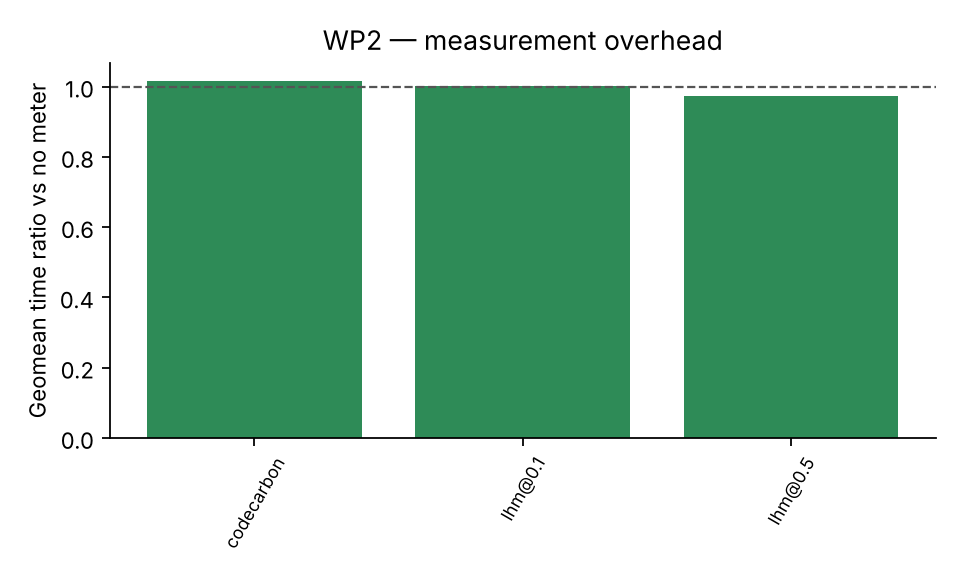
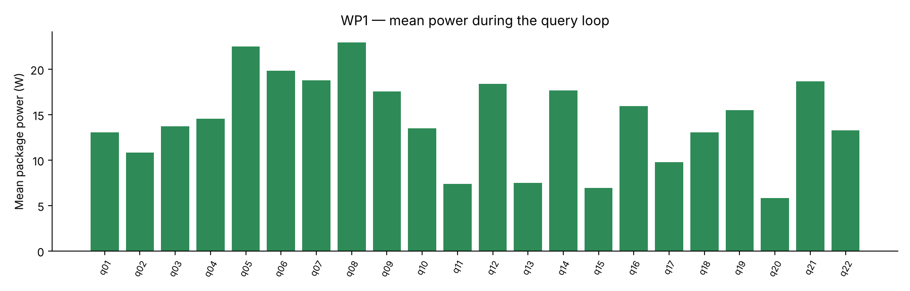
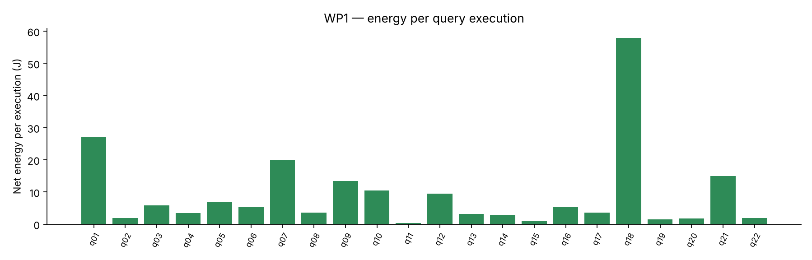
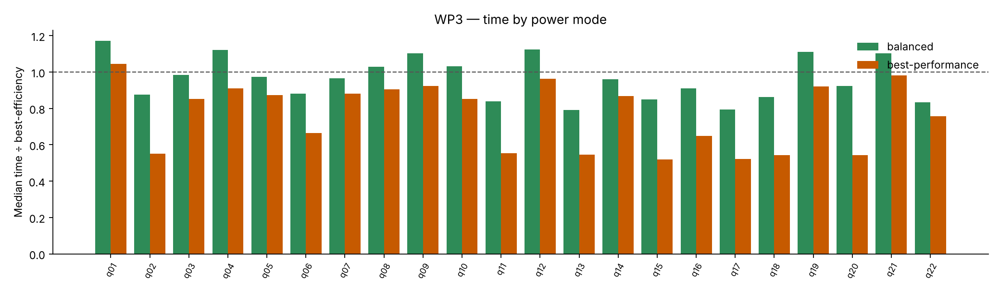
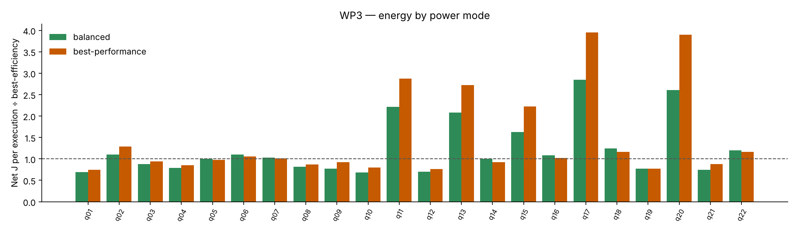

# 1. Purpose

My thirty benchmark cases were written to exercise GreenCode's rule catalogue, so an examiner could reasonably ask whether the energy pipeline only works on problems I planted. To answer that, and to act on my supervisor's guidance, I ran the standard TPC-H query set on my laptop under a written laboratory protocol, using the same measurement chain as the main experiment. The work was organised as five work packages, all run on 3 November 2026.

All results are **TPC-H-derived**: the data generator and queries are those of the TPC-H specification, but the runs are not audited by the TPC.

# 2. Apparatus and protocol

| Item | Value |
|---|---|
| Machine | Dell laptop, Intel Core Ultra 5 135U (12 cores / 14 threads, 2 P + 8 E + 2 LP-E), 32 GB RAM, Windows 11 Home |
| Database | PostgreSQL 18.6 (native), schema `tpch`, scale factor 1: 6,001,215 line items, 1.6 GB on disk with keys |
| PostgreSQL settings | `shared_buffers` 6 GB, `work_mem` 256 MB, `effective_cache_size` 16 GB, `max_parallel_workers_per_gather` 2, `jit` on, `track_io_timing` on |
| Data generation | DuckDB `tpch` extension (`CALL dbgen(sf=1)`), loaded with `COPY`, primary/foreign keys per the specification, `ANALYZE` |
| Energy reader | LibreHardwareMonitor → Intel RAPL CPU Package power, polled every 0.1 s, integrated over the timed loop; 6 s idle floor (minimum reading) subtracted |
| Timing | `perf_counter_ns` around `execute()` + `fetchall()`; `EXPLAIN (ANALYZE, BUFFERS)` once per query |
| Repetitions | at least 15 per query, raised automatically so every energy window spans ≥ 10 s (LHM refreshes about once a second); 3 warm-up runs; hot cache |
| Controls | mains power; Ollama stopped; power mode recorded; randomised query order per pass; 5 s cool-down; environment snapshot (CPU, memory, power plan, battery, process count, PostgreSQL config) stored with every run |

Pre-flight checks (`run_tpch.py --check`) refuse to start a work package on battery, without LibreHardwareMonitor, or with Ollama running. The full protocol is `docs/protocol.md`.

| WP | Question | Runs |
|---|---|---|
| WP1 Baseline | What do the 22 standard queries cost on this machine? | 22 queries × 3 passes, Balanced mode (plus 3 passes under Best Power Efficiency) |
| WP2 Measurement overhead | Does measuring change the measurement? | 22 queries × {no meter, LHM 0.1 s, LHM 0.5 s, CodeCarbon} |
| WP3 Power management | How much does the Windows power mode move time and energy? | 22 queries × {Best power efficiency, Balanced, Best performance} |
| WP4 Complex queries | Do heavier, anti-pattern queries behave differently? | 8 hand-written queries, 30+ repetitions |
| WP5 Optimised | Does GreenCode's rewrite reduce time and energy on them? | the 8 queries through the pipeline, AI-only vs GreenCode, qwen2.5-coder:7b |

# 3. WP2 — Does measuring change the measurement?

Median client time of each query under each meter, divided by the same query with no meter.

| query | none ms | codecarbon ÷ none | lhm@0.1 ÷ none | lhm@0.5 ÷ none |
|---|---|---|---|---|
| q01 | 2,093 | 0.90 | 0.91 | 0.79 |
| q02 | 447 | 1.06 | 1.03 | 1.01 |
| q03 | 358 | 1.05 | 0.98 | 1.00 |
| q04 | 198 | 1.02 | 1.01 | 0.88 |
| q05 | 371 | 0.96 | 0.95 | 0.93 |
| q06 | 407 | 1.08 | 1.07 | 1.08 |
| q07 | 984 | 1.04 | 1.04 | 1.04 |
| q08 | 231 | 0.88 | 0.88 | 0.86 |
| q09 | 832 | 1.00 | 1.01 | 0.93 |
| q10 | 776 | 0.95 | 0.96 | 0.88 |
| q11 | 191 | 1.08 | 0.96 | 1.00 |
| q12 | 718 | 0.99 | 0.97 | 0.86 |
| q13 | 3,433 | 1.14 | 1.16 | 1.19 |
| q14 | 154 | 1.00 | 1.04 | 1.02 |
| q15 | 520 | 0.99 | 1.00 | 0.97 |
| q16 | 431 | 1.07 | 1.05 | 1.06 |
| q17 | 1,971 | 1.17 | 1.08 | 1.11 |
| q18 | 5,751 | 1.03 | 0.98 | 1.01 |
| q19 | 89.1 | 0.96 | 1.00 | 0.83 |
| q20 | 1,337 | 1.01 | 0.96 | 0.98 |
| q21 | 857 | 1.01 | 1.04 | 0.93 |
| q22 | 126 | 0.99 | 1.01 | 1.19 |

## Summary

| meter | queries | geomean ratio | median ratio | min | max | Wilcoxon p (vs 1.0) |
|---|---|---|---|---|---|---|
| codecarbon | 22 | 1.02 | 1.01 | 0.88 | 1.17 | 0.26 |
| lhm@0.1 | 22 | 1.00 | 1.00 | 0.88 | 1.16 | 0.85 |
| lhm@0.5 | 22 | 0.97 | 0.99 | 0.79 | 1.19 | 0.34 |

A ratio of 1.00 means no overhead. The Wilcoxon test asks whether the paired log-ratios differ from zero across the 22 queries.



## Energy by method

| query | RAPL/LHM 0.1 s | RAPL/LHM 0.5 s | CodeCarbon | CodeCarbon ÷ RAPL | mean W (RAPL) |
|---|---|---|---|---|---|
| q01 | 25.1 | 39.8 | 80.3 | 3.20 | 14.8 |
| q02 | 1.64 | 3.63 | 12.9 | 7.89 | 7.79 |
| q03 | 8.39 | 8.01 | 19.6 | 2.34 | 25.5 |
| q04 | 2.69 | 4.20 | 7.72 | 2.86 | 17.6 |
| q05 | 6.70 | 9.13 | 16.8 | 2.50 | 21.1 |
| q06 | 5.15 | 5.31 | 15.9 | 3.09 | 15.9 |
| q07 | 20.1 | 20.6 | 49.7 | 2.47 | 20.2 |
| q08 | 3.77 | 4.00 | 9.01 | 2.39 | 21.0 |
| q09 | 14.0 | 17.9 | 38.6 | 2.75 | 18.3 |
| q10 | 9.24 | 15.0 | 28.9 | 3.13 | 15.5 |
| q11 | 0.28 | 0.24 | 6.02 | 21.2 | 5.48 |
| q12 | 8.55 | 13.0 | 27.6 | 3.22 | 15.1 |
| q13 | 1.99 | 2.46 | 120 | 60.6 | 4.34 |
| q14 | 2.82 | 2.93 | 7.53 | 2.67 | 20.9 |
| q15 | 0.69 | 2.92 | 13.4 | 19.5 | 5.34 |
| q16 | 5.59 | 5.74 | 17.0 | 3.05 | 15.9 |
| q17 | 3.15 | 3.02 | 64.8 | 20.6 | 5.26 |
| q18 | 60.6 | 54.3 | 226 | 3.74 | 12.9 |
| q19 | 1.15 | 1.71 | 3.56 | 3.11 | 16.5 |
| q20 | 7.49 | 1.39 | 40.3 | 5.38 | 10.0 |
| q21 | 12.5 | 18.0 | 37.4 | 2.98 | 16.1 |
| q22 | 2.60 | 2.15 | 6.10 | 2.34 | 22.6 |

CodeCarbon ÷ RAPL geomean: 4.61. On Windows CodeCarbon has no RAPL access and estimates from TDP × CPU load with no idle subtraction, so it cannot see the low-power group at all.

**Interpretation.** Polling the hardware counter every 100 ms has no measurable cost; the ±10 % scatter per query is ordinary run-to-run noise. I kept the 0.1 s setting for everything that followed. CodeCarbon's energy figures are not comparable with RAPL on this machine: it reports 2.4–3× the measured energy on CPU-heavy queries and 30–40× on the light ones, because on Windows it has no access to the counter and estimates from TDP and CPU load with no idle subtraction.

# 4. WP1 — Baseline

| query | passes | median ms | EXPLAIN exec ms | client/exec | mean W | net J / exec | J per 1000 rows | rows | parallel workers |
|---|---|---|---|---|---|---|---|---|---|
| q01 | 3 | 2,417 | 2,017 | 1.20 | 13.1 | 26.8 | 6,712 | 4 | 2 |
| q02 | 3 | 395 | 196 | 2.01 | 10.8 | 2.20 | 22.0 | 100 | 2 |
| q03 | 3 | 565 | 382 | 1.48 | 13.7 | 5.53 | 553 | 10 | 2 |
| q04 | 3 | 224 | 181 | 1.24 | 14.5 | 2.34 | 468 | 5 | 2 |
| q05 | 3 | 347 | 375 | 0.93 | 22.5 | 5.89 | 1,178 | 5 | 2 |
| q06 | 3 | 382 | 286 | 1.34 | 19.8 | 5.98 | 5,979 | 1 | 2 |
| q07 | 3 | 1,072 | 976 | 1.10 | 18.8 | 17.5 | 4,381 | 4 | 2 |
| q08 | 3 | 194 | 201 | 0.96 | 22.9 | 3.14 | 1,572 | 2 | 2 |
| q09 | 3 | 871 | 785 | 1.11 | 17.6 | 14.0 | 80.2 | 175 | 2 |
| q10 | 3 | 913 | 517 | 1.77 | 13.5 | 8.90 | 445 | 20 | 2 |
| q11 | 3 | 160 | 92.3 | 1.73 | 7.40 | 0.48 | 0.46 | 1048 | 0 |
| q12 | 3 | 644 | 507 | 1.27 | 18.4 | 9.25 | 4,625 | 2 | 2 |
| q13 | 3 | 3,260 | 1,171 | 2.78 | 7.46 | 11.7 | 279 | 42 | 0 |
| q14 | 3 | 179 | 145 | 1.23 | 17.6 | 2.61 | 2,610 | 1 | 2 |
| q15 | 3 | 450 | 258 | 1.75 | 6.94 | 0.98 | 977 | 1 | 0 |
| q16 | 3 | 440 | 279 | 1.58 | 15.9 | 5.08 | 0.28 | 18314 | 2 |
| q17 | 3 | 1,779 | 978 | 1.82 | 9.76 | 10.1 | 10,093 | 1 | 2 |
| q18 | 3 | 5,157 | 4,371 | 1.18 | 13.0 | 54.2 | 951 | 57 | 2 |
| q19 | 3 | 98.9 | 71.3 | 1.39 | 15.5 | 1.06 | 1,058 | 1 | 2 |
| q20 | 3 | 1,229 | 501 | 2.46 | 5.82 | 1.54 | 8.29 | 186 | 0 |
| q21 | 3 | 841 | 780 | 1.08 | 18.7 | 14.1 | 141 | 100 | 2 |
| q22 | 3 | 196 | 153 | 1.28 | 13.2 | 1.86 | 266 | 7 | 2 |

**One pass over the 22 queries:** 21.8 s of query time, 205 J net (TPC-Energy-style energy per query set), 9.4 W average net power.

**Power groups:** 17 queries at ≥10 W mean (q01, q02, q03, q04, q05, q06, q07, q08, q09, q10, q12, q14, q16, q18, q19, q21, q22); 5 queries below 10 W (q11, q13, q15, q17, q20). The low-power group's client time exceeds its own EXPLAIN ANALYZE time by 2.07× on average versus 1.28× for the rest.





**Interpretation.** The queries fall into two groups. Seventeen run at 13–23 W with client time close to their own EXPLAIN ANALYZE time. Five — Q11, Q13, Q15, Q17, Q20 — run at 6–10 W and take about twice as long as their EXPLAIN ANALYZE. Those five are exactly the plans PostgreSQL cannot parallelise (correlated subqueries, the Q15 view, the Q13 NOT LIKE outer join): a single-threaded backend is being scheduled onto the processor's efficiency cores while parallel plans get the performance cores. An earlier three-pass baseline made under Best Power Efficiency (before I noticed the setting) gave 23.0 s and 202 J per pass, with the serial group 14 % slower and using 37 % less energy, and Q2 in the slow group too.

# 5. WP3 — Power management

Reference plan: **best-efficiency**. Ratios < 1 are faster / lower energy than the reference.

| query | best-efficiency ms | best-efficiency J/exec | balanced time ÷ | balanced energy ÷ | best-performance time ÷ | best-performance energy ÷ |
|---|---|---|---|---|---|---|
| q01 | 1,656 | 37.1 | 1.17 | 0.69 |  |  | 1.05 | 0.75 |
| q02 | 447 | 1.95 | 0.87 | 1.10 |  |  | 0.55 | 1.29 |
| q03 | 363 | 7.98 | 0.98 | 0.88 |  |  | 0.85 | 0.94 |
| q04 | 176 | 3.41 | 1.12 | 0.79 |  |  | 0.91 | 0.85 |
| q05 | 355 | 6.83 | 0.97 | 1.00 |  |  | 0.87 | 0.98 |
| q06 | 431 | 4.94 | 0.88 | 1.10 |  |  | 0.66 | 1.05 |
| q07 | 1,005 | 19.3 | 0.96 | 1.03 |  |  | 0.88 | 1.01 |
| q08 | 199 | 4.07 | 1.03 | 0.81 |  |  | 0.90 | 0.87 |
| q09 | 755 | 18.0 | 1.10 | 0.77 |  |  | 0.92 | 0.92 |
| q10 | 697 | 12.4 | 1.03 | 0.68 |  |  | 0.85 | 0.79 |
| q11 | 191 | 0.21 | 0.84 | 2.22 |  |  | 0.55 | 2.88 |
| q12 | 597 | 12.7 | 1.12 | 0.70 |  |  | 0.96 | 0.76 |
| q13 | 3,998 | 3.10 | 0.79 | 2.08 |  |  | 0.55 | 2.72 |
| q14 | 158 | 2.90 | 0.96 | 1.01 |  |  | 0.87 | 0.92 |
| q15 | 525 | 0.67 | 0.85 | 1.63 |  |  | 0.52 | 2.22 |
| q16 | 460 | 5.36 | 0.91 | 1.08 |  |  | 0.65 | 1.02 |
| q17 | 2,127 | 1.74 | 0.79 | 2.84 |  |  | 0.52 | 3.95 |
| q18 | 5,762 | 55.5 | 0.86 | 1.25 |  |  | 0.54 | 1.16 |
| q19 | 76.3 | 1.56 | 1.11 | 0.77 |  |  | 0.92 | 0.77 |
| q20 | 1,330 | 0.82 | 0.92 | 2.61 |  |  | 0.54 | 3.89 |
| q21 | 786 | 16.5 | 1.10 | 0.74 |  |  | 0.98 | 0.87 |
| q22 | 148 | 2.13 | 0.83 | 1.20 |  |  | 0.76 | 1.16 |

## Summary (geometric means across queries)

| plan | queries | time ÷ ref | energy ÷ ref |
|---|---|---|---|
| balanced | 22 | 0.96 | 1.11 |
| best-performance | 22 | 0.74 | 1.23 |

## One pass over the query set

| plan | query time (s) | net energy (J) | avg net W |
|---|---|---|---|
| balanced | 20.3 | 213 | 10.5 |
| best-efficiency | 22.2 | 219 | 9.85 |
| best-performance | 14.9 | 223 | 15.0 |

## Serial (<10 W under best-efficiency) queries only: q02, q11, q13, q15, q17, q20

| plan | queries | time ÷ ref | energy ÷ ref |
|---|---|---|---|
| balanced | 6 | 0.84 | 1.99 |
| best-performance | 6 | 0.54 | 2.65 |





**Interpretation.** For the serial queries, Best Performance halves the time (0.54×) and multiplies the energy per execution by 2.65; Q13 goes from 4.0 s to 2.2 s, Q18 from 5.8 s to 3.1 s. The parallel queries barely move. Across a full pass the power mode changes the time by 33 % and the energy by 2 %: the laptop trades time for power at almost constant energy on this workload, but for serial work the efficient mode is a genuine 2–2.6× energy saving bought with half the speed. Two conclusions: laptop energy figures are meaningless unless the power mode is stated (the protocol now requires it, and Balanced is the standard), and the relationship between time and energy that hypothesis H4 questions is not a property of the SQL alone but of how the operating system schedules it.

# 6. WP4 — Complex queries

| query | median ms | EXPLAIN exec ms | mean W | net J / exec |
|---|---|---|---|---|
| c01 | 1,230 | 458 | 5.90 | 2.27 |
| c02 | 2,190 | 909 | 5.78 | 4.02 |
| c03 | 3,391 | 1,896 | 13.1 | 33.7 |
| c04 | 4,088 | 1,709 | 5.66 | 7.35 |
| c05 | 150 | 108 | 6.42 | 0.33 |
| c06 | 336 | 226 | 18.4 | 4.80 |
| c07 | 471 | 24.4 | 13.2 | 4.44 |
| c08 | 588 | 453 | 6.63 | 1.50 |

The eight queries (`benchmarks/tpch/complex/`) were written on the TPC-H schema to contain one or more of the catalogue's anti-patterns: c01 correlated aggregates and a function on a date column; c02 NOT IN over lineitem and SELECT \*; c03 function on a column and DISTINCT over a window; c04 correlated subqueries and IN (subquery); c05 COUNT(\*) > 0, leading-wildcard LIKE and ORDER BY without LIMIT; c06 arithmetic on an indexed column and DISTINCT over a join; c07 SELECT \* over a wide join; c08 three correlated aggregates per supplier.

# 7. WP5 — The complex queries through GreenCode

Speed-up = original median ÷ candidate median; energy ratio = original net J ÷ candidate net J (both > 1 = candidate better).

| Case | Anti-patterns planted | AI-only | GreenCode | What the model did (see `wp5/candidates.md`) |
|---|---|---|---|---|
| c01 | correlated COUNT/SUM per customer; `extract()` on date | **5.33×**, energy 0.54 | rejected (columns renamed) | Both pre-aggregated orders into a derived table. GreenCode's version renamed `orders_1995`/`spend_1995` to `orders_count`/`total_spend` and used an inner join — rows matched, column names did not, so verification rejected it. Neither fixed the `extract()` predicate despite the SQL003 finding. |
| c02 | `NOT IN (subquery)` over lineitem; `SELECT *` | 1.04×, energy 1.49 | **330×**, energy **69.7** | AI-only returned the query unchanged. GreenCode rewrote to `NOT EXISTS` / `EXISTS` and expanded `SELECT *` — PostgreSQL's hashed-subplan NOT IN over 6 M rows collapses to an anti-join. |
| c03 | function on column; DISTINCT over window | rejected | rejected | Identical candidates under both conditions: both dropped DISTINCT, returning 200 001 rows instead of 300. A model limitation, not a guidance effect. |
| c04 | correlated subqueries in SELECT/WHERE; `IN (subquery)` | 1.26×, energy 1.31 | 1.38×, energy 0.23 | Faster under guidance but 4× the energy: the rewrite moved a serial plan onto a parallel one. |
| c05 | `COUNT(*) > 0`; leading-wildcard LIKE; no LIMIT | 0.79×, energy 0.62 | 0.71×, energy 0.53 | Correct but slower under both — the planner already handled the original well. |
| c06 | arithmetic on column; DISTINCT over join | 0.53×, energy 1.61 | 0.84×, energy 1.31 | Correct but slower under both; guidance halved the damage. |
| c07 | `SELECT *` over a wide join | rejected | **1.67×**, energy 0.89 | AI-only changed the result set; GreenCode's explicit column list was verified. |
| c08 | three correlated aggregates per supplier | 0.66×, energy **0.14** | 0.66×, energy 0.16 | Both produced the textbook pre-aggregation — over *all* 6 M lineitems, not just Japan's suppliers — so 1.5× slower and 7× the energy. The "right" rewrite was the wrong one for this data. |

## Per-condition (from `summary.json`)

| | AI-only | GreenCode |
|---|---|---|
| Verified / generated | 6 / 8 (75 %) | 6 / 8 (75 %) |
| Geomean speed-up, per-protocol (5 pairs) | 0.82× | 2.83× |
| Geomean speed-up, intention-to-treat (8) | 1.09× | 2.04× |
| Geomean energy ratio, per-protocol | 0.77 | 1.12 |

With eight cases nothing reaches significance (H2 per-protocol p = 0.16); the value of WP5 is qualitative. Four observations for the report:

1. **Guidance found the one big win.** c02's `NOT IN` → `NOT EXISTS` is a 330× / 70× result that the unguided model did not attempt.
2. **Correct-but-slower is common** (c05, c06, c08 under both conditions). Verification passes, the benchmark catches it. This reproduces Peng et al. and is the strongest argument for measuring rather than trusting.
3. **Time and energy diverge in both directions.** c01 AI-only: 5.3× faster, 1.8× more energy. c08: 1.5× slower, 7× more energy. c04 GreenCode: 1.4× faster, 4× more energy. The mechanism is the serial→parallel plan change interacting with the laptop's P-/E-core scheduling that WP3 exposed. H4 is not a corner case here; it is the norm.
4. **Rejections are informative.** c01 GreenCode failed only on column names (the output contract is strict by design); c03 failed identically under both conditions (model limitation); c07 AI-only changed the result set where the guided version kept it.

The full text of every candidate, with its verification results and the prompt that produced it, is in `docs/lab/wp5/candidates.md`.

# 8. What the laboratory work establishes

1. **The measurement chain works on a workload I did not design.** RAPL energy read through LibreHardwareMonitor at no measurable overhead, idle-subtracted, with every window long enough to be trusted (coverage 1.00 on every run).
2. **Two laptop confounds are now quantified rather than ignored:** the Windows power mode, and the hybrid-core scheduler that runs serial PostgreSQL backends on efficiency cores. Both are recorded with every run, and results are only compared within a mode.
3. **The project's central claims survive contact with standard queries.** Static-analysis guidance found a rewrite the unguided model missed (c02: 330× faster, 70× less energy); verification caught the wrong rewrites (c01, c03, c07); and only measurement caught the rewrites that were right but worse (c05, c06, c08 — c08 at seven times the energy).
4. **Time and energy diverge in both directions**, through the same mechanism in WP3 and WP5. H4 is not a corner case on this hardware; it is the norm.

# 9. Reproducing the runs

```
pip install --user duckdb
python scripts\load_tpch.py --sf 1
python scripts\run_tpch.py --validate
python scripts\run_tpch.py --check
python scripts\run_tpch.py --wp 2
python scripts\run_tpch.py --wp 1 --passes 3 --plan-label balanced
python scripts\run_tpch.py --wp 3 --plan-label <mode>        # once per Windows power mode
python scripts\run_tpch.py --wp 4 --repetitions 30 --plan-label balanced
python scripts\run_tpch.py --wp 5 --force                     # Ollama running
python scripts\run_tpch.py --export lab.csv
python scripts\analyse_lab.py lab.csv --out lab-analysis
```

Raw data: `docs/lab/lab-2026-11-03-all.csv` (297 runs, one row per query × condition × pass, with the environment of each).
